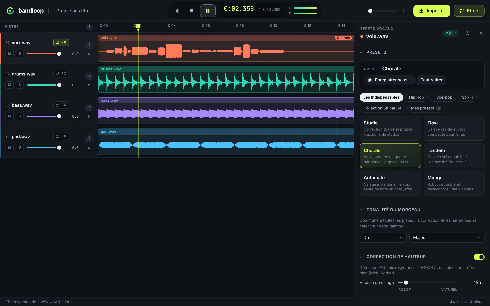

# Bandloop

Studio audio multipiste de bureau pour macOS et Windows, avec un moteur d'effets
vocaux et des presets. Construit avec **Electron** et la **Web Audio API**.



## Fonctionnalités

- **Multipiste** : import (dialogue ou glisser-déposer), timeline avec formes
  d'onde et zoom, lecture synchronisée à l'échantillon, play / pause / stop,
  déplacement de la tête de lecture.
- **Enregistrement au micro** : choix du micro, VU-mètre d'entrée, compte à
  rebours, pistes existantes jouées en guide, prise calée à l'échantillon avec
  compensation (et mesure) de la latence. La prise devient une piste normale,
  avec presets et effets vocaux appliqués après coup.
- **Arrangement** : glisser un clip à gauche ou à droite pour le déplacer dans le
  temps (aimanté sur 0, la tête de lecture, les autres clips et la grille ;
  Maj pour un placement libre), en haut ou en bas pour changer la piste de
  place ; poignée ⠿ sur chaque piste ; bouton « + » sous la dernière piste.
- **Montage des clips** (non destructif) : découper (S ou Ctrl/⌘+K), sélectionner
  une portion en glissant (début, fin et durée affichés), la supprimer (Suppr :
  le reste se recolle ; Maj+Suppr : un blanc reste), rogner les bords, déplacer
  chaque morceau, annuler / rétablir (Ctrl/⌘+Z). Coupes à l'échantillon près,
  micro-fondus anti-clic aux jointures.
- **Projets** : fichier `.bandloop` autonome (tout l'audio embarqué : fichiers
  importés tels quels, prises micro en FLAC sans perte), Nouveau / Ouvrir /
  Enregistrer / Enregistrer sous, titre avec `*` si modifié, confirmation
  avant de perdre des modifications.
- **Export du mix** en WAV (24/16 bits) ou MP3 (128–320 kb/s), effets et
  presets compris, avec progression et limiteur à −1 dBFS.
- **Console** : volume en dB, panoramique, mute et solo par piste, VU-mètre
  stéréo et limiteur sur le master.
- **Moteur vocal** :
  - correction de hauteur, de l'instantané (robot) au lent (naturel), calée sur
    la tonalité et la gamme du morceau ;
  - transposition et formants ;
  - jusqu'à 4 harmonies dans la gamme ;
  - vocodeur et bourdon ;
  - chaîne d'effets temps réel : téléphone, chœur, delay, réverb, distorsion,
    bitcrush, modulation en anneau, compresseur, égaliseur.
- **Presets** : 24 presets fournis en 5 catégories, plus tes propres presets à
  créer, modifier, renommer, supprimer, enregistrés sur disque.

## Démarrer

```bash
npm install
npm run samples   # génère des pistes de démo dans ./samples, dont une voix de synthèse
npm start
```

Importe `samples/voix.wav`, clique sur **FX** sur la piste, puis essaie les
presets. Pour la correction et les harmonies, règle d'abord la **tonalité du
morceau** (ici La mineur, c'est-à-dire `La` + `Mineur naturel`).

| Raccourci                       | Action                                     |
| ------------------------------- | ------------------------------------------ |
| Espace                          | Lecture / pause                            |
| Entrée                          | Stop (retour au début)                     |
| Début                           | Retour au début sans arrêter               |
| Clic sur la timeline            | Sélectionner la piste et déplacer la tête  |
| S ou Ctrl/⌘+K                   | Découper le clip                           |
| Suppr (Maj+Suppr)               | Supprimer la portion ou le clip            |
| Ctrl/⌘+Z, Ctrl/⌘+Maj+Z          | Annuler, rétablir (montage)                |
| Alt+← / → , Alt+↑ / ↓           | Décaler le clip, changer la piste de place |
| Double-clic sur un curseur      | Valeur par défaut                          |
| Glisser vertical sur le pan (⇧) | Réglage (fin avec ⇧)                       |

## Scripts

| Commande           | Rôle                                                                                                                                                       |
| ------------------ | ---------------------------------------------------------------------------------------------------------------------------------------------------------- |
| `npm start`        | Lance l'app en développement                                                                                                                               |
| `npm test`         | Tests unitaires (`node:test`, sans Electron)                                                                                                               |
| `npm run test:e2e` | Tests de bout en bout dans l'app Electron (enregistrement, déplacement, montage, projets, export) ; sous Linux sans écran : `xvfb-run -a npm run test:e2e` |
| `npm run samples`  | Génère des WAV de démo                                                                                                                                     |
| `npm run dist:mac` | Construit un `.dmg` (à lancer sur un Mac)                                                                                                                  |
| `npm run dist:win` | Construit un installeur `.exe` (NSIS)                                                                                                                      |

## Documentation

- [docs/ARCHITECTURE.md](docs/ARCHITECTURE.md) : processus Electron, graphe
  audio, transport, interface.
- [docs/MONTAGE.md](docs/MONTAGE.md) : découper, sélectionner, supprimer, rogner,
  annuler ; modèle non destructif, **précision des coupes, clics aux jointures,
  limites**.
- [docs/PROJETS-ET-EXPORT.md](docs/PROJETS-ET-EXPORT.md) : format `.bandloop`,
  choix des formats audio, export, **limites** (taille, durées, qualité MP3).
- [docs/ENREGISTREMENT.md](docs/ENREGISTREMENT.md) : enregistrement au micro,
  calage et latence, **limites** (latence, qualité du micro, monitoring sans
  écho).
- [docs/MOTEUR-VOCAL.md](docs/MOTEUR-VOCAL.md) : briques audio de chaque effet,
  algorithmes, presets, **limites de qualité**.
