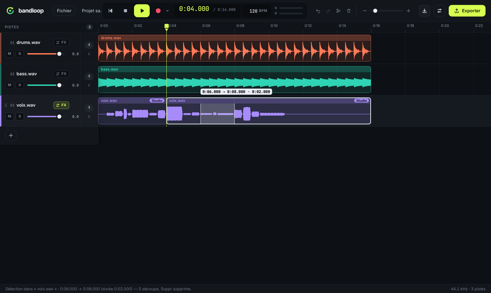
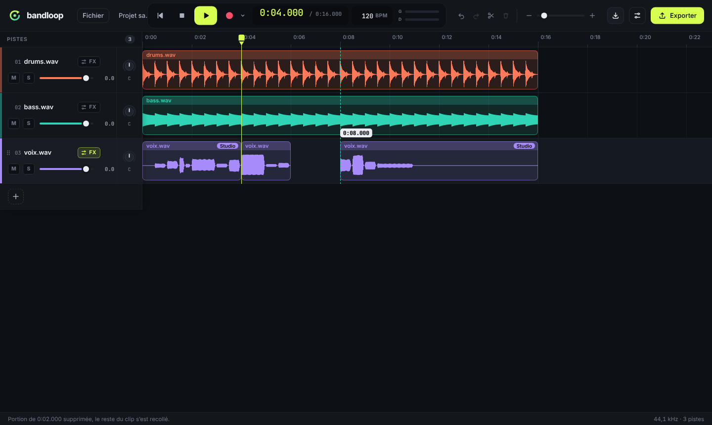

# Montage des clips



## Utilisation

Chaque clip a trois zones, comme dans la plupart des DAW :

| Zone du clip                   | Curseur | Glisser                                                                                  |
| ------------------------------ | ------- | ---------------------------------------------------------------------------------------- |
| **En-tête** (bande du nom)     | main    | Déplace **ce clip** dans le temps ; vers le haut ou le bas, change la piste de place     |
| **Corps** (forme d'onde)       | texte   | Sélectionne une **portion** du clip (surlignée, avec début → fin · durée)                |
| **Bords** (6 px à l'intérieur) | ↔       | **Rogne** le début ou la fin, sans réimporter : l'audio caché peut être ramené en tirant |

Un simple clic dans un clip le sélectionne (contour blanc) et y place la tête
de lecture. La barre d'état affiche le début, la fin et la durée de la
sélection.

| Action                          | Clavier                   | Bouton / menu                  |
| ------------------------------- | ------------------------- | ------------------------------ |
| Découper                        | **S** ou Ctrl/⌘+K         | ✂ ; Édition ▸ Découper le clip |
| Supprimer (le reste se recolle) | **Suppr** ou ⌫            | 🗑 ; Édition ▸ Supprimer       |
| Supprimer en laissant un blanc  | Maj+Suppr                 |                                |
| Annuler                         | Ctrl/⌘+Z                  | ↶ ; Édition ▸ Annuler          |
| Rétablir                        | Ctrl/⌘+Maj+Z (ou Ctrl+Y)  | ↷ ; Édition ▸ Rétablir         |
| Décaler le clip sélectionné     | Alt+← / → (Maj : par 1 s) |                                |
| Changer la piste de place       | Alt+↑ / ↓                 | poignée ⠿                      |
| Désélectionner                  | Échap                     |                                |

- **Découper** :
  - si une portion est sélectionnée, la piste est coupée à ses deux bords et
    la portion devient un clip à part entière ;
  - sinon, la coupe se fait à la **tête de lecture**, dans le clip
    sélectionné, ou dans le clip de la piste sélectionnée qui est sous la
    tête.
  - Les deux morceaux restent bout à bout sur la même piste.
- **Supprimer une portion** : la partie située après la portion recule pour
  combler le trou (_ripple_ limité à ce clip : les autres clips et les
  autres pistes ne bougent pas). Avec **Maj**, un blanc reste à la place.
- **Supprimer le clip** : sans portion sélectionnée, c'est le clip entier qui
  disparaît.
- **Aimantation** : sur 0:00, la tête de lecture, les bords de tous les autres
  clips (toutes pistes) et la grille de la règle, à moins de 8 pixels. Elle
  s'applique au déplacement, au rognage et aux deux bords d'une sélection.
  Un trait turquoise montre le point d'accroche. **Maj** maintenu pendant le
  geste la désactive.
- Les morceaux gardent le **preset vocal et les réglages** de leur piste :
  effets, volume, pan, mute et solo restent ceux de la piste.
- **Pendant un enregistrement**, tout le montage est bloqué : souris,
  raccourcis, boutons et annulation. Un message l'indique.



## Comment ça marche : montage non destructif

Une piste garde **son audio intact**. Ses clips ne sont que des fenêtres sur
cet audio :

```
clip = { start, offset, length }
  start   position sur la timeline (secondes, toujours calée sur un échantillon)
  offset  premier échantillon utilisé dans l'audio de la piste (entier)
  length  nombre d'échantillons (entier)
```

Découper, rogner, supprimer ou déplacer ne fait que modifier ces fenêtres
(`audio/clips.js`, fonctions pures et testées). Aucun audio n'est copié ni
recalculé, ce qui garde trois avantages :

- les opérations sont instantanées, même sur une piste longue ;
- un rognage peut **toujours être défait** en tirant le bord : l'audio est
  encore là ;
- les effets vocaux lourds (correction, harmonies…) ne sont pas recalculés
  après un montage.

À la lecture **et** à l'export, la même fonction (`scheduleClips`) crée une
source Web Audio par clip, qui démarre à `start` et lit `length` échantillons
à partir de `offset`. Toutes les sources d'une piste entrent dans la même
chaîne d'effets. Tu exportes donc exactement ce que tu entends.

Dans le projet (`project.json`, format **version 2**), chaque piste a une liste
`clips` en échantillons, plus la fréquence d'échantillonnage de son audio. Si le
projet est rouvert sur une machine dont la carte son tourne à une autre
fréquence, les positions sont converties. Les projets version 1 (sans clips)
s'ouvrent toujours : chaque piste y devient un clip unique.

### Annuler / rétablir

Chaque opération de montage enregistre un instantané « avant / après » de
l'arrangement : ordre des pistes et clips de chaque piste, soit quelques
nombres par clip, jamais d'audio (`audio/history.js`). Annuler, c'est
restaurer l'instantané « avant ». L'historique garde les **100** dernières
opérations.

Sont annulables : découpe, suppression d'une portion ou d'un clip, rognage,
déplacement d'un clip ou d'une piste dans le temps (souris et Alt+flèches),
changement d'ordre des pistes (glisser ou poignée).

Dans un champ de texte (nom du projet, tempo), Ctrl/⌘+Z annule la saisie,
pas le montage.

## Précision et limites

### Précision des coupes

- Le point de coupe est **arrondi à l'échantillon** le plus proche : à
  44,1 kHz, l'erreur maximale est de ±11 µs. Les débuts de clips sont
  eux aussi calés sur un échantillon. La lecture et l'export sont donc
  exacts, sans interpolation entre échantillons.
- La vraie limite vient de la **souris** : au zoom par défaut, 1 pixel vaut
  20 ms. Pour couper à un endroit précis :
  - zoome, puis place la tête de lecture (clic sur la règle) et appuie
    sur **S** ;
  - ou laisse l'aimant accrocher la coupe sur un repère (tête, grille,
    bord d'un autre clip).
- Il n'y a pas encore de saisie numérique d'un temps, ni d'aimantation sur
  les temps et mesures du tempo (la grille suit la règle en secondes).

### Clics aux jointures

- **Coupe laissée en place** : les deux morceaux se suivent échantillon par
  échantillon. Aucun fondu n'est ajouté et le son est strictement identique
  à l'original (vérifié par les tests).
- **Jointure discontinue** (portion supprimée puis recollée, morceau déplacé,
  bord rogné) : un saut brusque de la forme d'onde produirait un clic. Bandloop
  applique un **micro-fondu linéaire de 4 ms**, en sortie du morceau de gauche
  et en entrée de celui de droite.
  - Cela supprime le clic, mais crée un **creux de niveau** d'environ
    4 ms. Sur une note tenue, une oreille attentive peut l'entendre comme une
    minuscule respiration.
  - Ce n'est pas un vrai fondu enchaîné (_crossfade_) : les deux morceaux
    ne se chevauchent pas.
  - Pour une jointure inaudible, coupe de préférence dans un silence ou
    juste avant une attaque.
- Les bords d'origine du fichier ne sont jamais modifiés : un fichier qui
  commence brusquement reste tel quel.
- Fondus réglables à la souris et crossfade automatique : pas encore.

### Ce qui n'est pas encore géré

- **Déplacer un morceau vers une autre piste** : les clips sont des fenêtres
  sur l'audio de leur propre piste. En glissant verticalement l'en-tête,
  c'est la piste entière qui change de place.
- **Clips qui se chevauchent** : c'est autorisé, et ils sont **additionnés**.
  Ni « le clip du dessus l'emporte », ni fondu enchaîné.
- Pas de copier / coller / dupliquer de clip, de sélection de plusieurs clips,
  de portion à cheval sur plusieurs clips ou pistes, ni de découpe de toutes
  les pistes à la fois.
- Pas de gain par clip, ni de déplacement du contenu dans un clip fixe
  (_slip edit_).
- **Effets vocaux lourds** (correction, harmonies, vocodeur) : ils sont
  calculés sur l'audio complet de la piste, puis découpés.
  - Avantage : rien n'est recalculé après un montage.
  - Inconvénient : un morceau déplacé emporte sa correction telle qu'elle
    était calculée dans son contexte d'origine.
  - Les effets temps réel (réverb, delay) sont appliqués après les clips : la
    traîne d'un morceau continue naturellement dans un blanc.
- **L'annulation ne couvre que l'arrangement** :
  - elle ne couvre pas le volume, le pan, le mute ou le solo, les effets et
    presets, le tempo, ni l'ajout ou la suppression d'une piste ou d'une
    prise ;
  - une piste supprimée ne revient pas avec Ctrl+Z ;
  - l'historique est vidé à l'ouverture d'un projet ou sur « Nouveau », et
    il n'est pas enregistré dans le projet.
- **Taille des projets** : le montage étant non destructif, l'audio supprimé
  reste dans le fichier `.bandloop` (il peut être ramené en rognant). Un projet
  ne rétrécit donc pas quand on supprime des portions.
- Une version plus ancienne de Bandloop refuse d'ouvrir un projet version 2
  (avec un message clair).

## Tests

- **Unitaires** (`test/clips.test.js`) :
  - découpe à l'échantillon ;
  - portion → clip ;
  - suppression avec et sans recollage ;
  - rognage borné par l'audio disponible, par 0:00 et par 10 ms minimum ;
  - fondus seulement aux jointures discontinues ;
  - planification de la lecture au milieu d'un clip ;
  - conversion de fréquence ;
  - historique (annuler, rétablir, limite, geste en cours).
- **Format** (`test/project.test.js`) : clips enregistrés et relus, projet v1
  toujours lisible, montage illisible refusé.
- **De bout en bout dans Electron** (`test/e2e/edit.e2e.js`), à la souris et
  au clavier. Le fichier de test a des échantillons quasi uniques, ce qui
  permet de savoir d'où vient chaque échantillon du rendu.
  1. **S** coupe à la tête ; le rendu est identique à l'original, sans aucun
     fondu.
  2. Glisser sélectionne une portion ; la fin s'aimante sur la graduation ;
     début, fin et durée sont affichés.
  3. **Suppr** retire la portion et recolle le reste.
  4. Un morceau est déplacé par son en-tête, puis rogné par son bord.
  5. Annuler ×4 revient au clip d'origine ; rétablir ×4 revient au montage
     final.
  6. Pendant un enregistrement, souris, raccourcis et annulation sont sans
     effet.
  7. **Enregistrer → fermer complètement l'application → relancer →
     rouvrir** : mêmes clips (en échantillons), même rendu au bit près, même
     mix exporté (effets compris) au bit près, preset conservé.
  8. Clip entier supprimé ; Maj+Suppr laisse un blanc.

  À chaque étape, le rendu hors temps réel de la piste est comparé
  **échantillon par échantillon** à ce que le modèle prévoit. Seules les
  quelques millisecondes de micro-fondu sont exclues de la comparaison.
