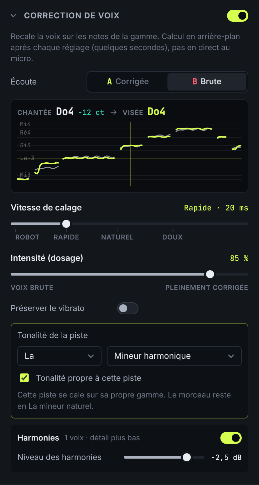

# Moteur vocal et presets

Le moteur vocal est fait de **briques combinables**. Chaque preset est une
combinaison enregistrée de leurs réglages (`vocal/settings.js`). Il a deux
étages.

```
                    ┌──────────── Étage de hauteur (hors temps réel, Web Worker) ────────────┐
voix (mono) ──YIN──▶│ correction → PSOLA voix principale ─┐                                  │
 (analyse en cache) │ harmonies  → PSOLA × N voix ────────┼─▶ stéréo ─▶ AudioBuffer rendu    │
                    │ vocodeur (FFT)  ·  bourdon (synthé) ┘                                  │
                    └────────────────────────────────────────────────────────────────────────┘
                                                   │
                    ┌──────────── Chaîne temps réel (nœuds Web Audio, ordre libre) ──────────┐
                    │ téléphone · chœur · delay · réverb · distorsion · bitcrush · anneau ·  │
                    │ compresseur · égaliseur                                                │
                    └────────────────────────────────────────────────────────────────────────┘
```

**Pourquoi deux étages ?** La correction de hauteur de qualité demande une
analyse précise et une resynthèse fine. Sur un fichier déjà enregistré, on peut
la calculer hors temps réel, sans latence et avec plus de soin, comme le font
Melodyne ou les rendus d'insert des DAW. Le résultat remplace l'audio lu par la
piste. Le calcul se relance 250 ms après le dernier changement, sans couper la
lecture. Les effets « classiques » restent en temps réel et se règlent pendant
l'écoute. L'analyse de hauteur, la partie coûteuse, est faite une seule fois
par piste.

La **tonalité** (tonique et gamme) est réglée pour tout le morceau et ne fait
pas partie des presets : un preset fonctionne dans n'importe quelle tonalité.
Une piste peut avoir **sa propre tonalité** (voir ci-dessous).

## Correction de voix : réglages manuels



La section **Correction de voix** du panneau FX regroupe tout ce qu'on règle
d'habitude dans un autotune. Un preset remplit ces réglages, qu'on peut
ensuite modifier à la main.

| Réglage                | Effet                                                                                                                                                                                                                                                                             |
| ---------------------- | --------------------------------------------------------------------------------------------------------------------------------------------------------------------------------------------------------------------------------------------------------------------------------- |
| Interrupteur           | Active la correction (le reste des effets n'est pas touché)                                                                                                                                                                                                                       |
| **Vitesse de calage**  | Temps mis pour ramener la voix sur la note : 0 ms = **robot** (saut de note en note, vibrato effacé), ~20 ms rapide (pop moderne), ~80 ms **naturel**, 200 ms et plus **doux**. Curseur à échelle « racine » : un tiers de sa course couvre 0-45 ms, là où l'effet change le plus |
| **Intensité (dosage)** | Part de l'écart corrigée : 0 % = voix brute, 50 % = moitié du chemin, 100 % = note juste. C'est un dosage de la **hauteur**, pas un mélange de deux signaux : pas d'effet de phase ni de doublage                                                                                 |
| Préserver le vibrato   | La note visée et l'écart sont calculés sur la hauteur lissée (~150 ms) : le centre de la note est corrigé, l'oscillation du vibrato passe telle quelle, même à vitesse robot                                                                                                      |
| **Écoute A / B**       | A = voix corrigée, B = voix brute (sans correction ni harmonies ; la chaîne d'effets reste active). Simple écoute : rien n'est modifié, enregistré ni exporté autrement                                                                                                           |
| Tonalité               | Celle du morceau par défaut ; la case « Tonalité propre à cette piste » donne à la piste sa tonique et sa gamme (ex. un chœur dans une autre gamme)                                                                                                                               |
| Harmonies              | Interrupteur (la première activation ajoute une voix à la tierce) et **niveau commun** à toutes les voix ; intervalles et panoramiques dans la section « Harmonies »                                                                                                              |

- **Note chantée → note visée** : au-dessus des curseurs, la note chantée à
  la tête de lecture, son écart en cents (turquoise sous 25 cents, ambre
  au-delà) et la note visée. En dessous, les 4 secondes autour de la tête :
  - lignes de la gamme ;
  - voix chantée (gris) ;
  - voix corrigée (citron).
- **Presets** : dès qu'un réglage s'écarte du preset, la mention « modifié »
  apparaît, avec « Revenir au preset » et « Enregistrer sous… » (nouveau
  preset personnel). La tonalité n'est jamais enregistrée dans un preset.
- **Annulation** : tous ces réglages, et ceux du reste du panneau FX, entrent
  dans l'historique (Ctrl/⌘+Z).
  - Les mouvements d'un même curseur à moins de 1,5 s d'intervalle forment
    une seule entrée, qui revient à la valeur d'avant le geste.
  - La tonalité du morceau est aussi annulable.
  - L'écoute A/B ne l'est pas, ce n'est pas une modification.
- **Pendant un enregistrement**, le panneau est grisé et bloqué ; l'annulation
  aussi.
- **Projet** : réglages manuels, tonalité propre à la piste, preset et
  contournement sont enregistrés. L'écoute A/B ne l'est pas : on rouvre
  toujours en A.

### Ce qui n'est pas proposé

- **Retouche note par note** (déplacer une note précise, comme dans un éditeur
  graphique) : il faudrait segmenter la voix en notes et éditer une courbe à
  la souris. C'est un éditeur à part entière, laissé de côté.
- **Limites basse / haute de détection** : la plage (70-1100 Hz) est fixée
  dans l'analyse, faite une seule fois par piste et mise en cache. La rendre
  réglable relancerait l'analyse complète à chaque changement : non ajouté.
- **Correction en direct au micro** : la correction se calcule après la prise,
  comme le reste de l'étage de hauteur.

### Temps de recalcul

Mesuré dans le conteneur de test (sans carte graphique), délai de 250 ms
après le dernier changement compris :

| Voix  | 1er calcul (avec analyse) | Changer la vitesse | Ajouter une harmonie |
| ----- | ------------------------- | ------------------ | -------------------- |
| 16 s  | 0,7 s                     | 0,3 s              | 0,4 s                |
| 3 min | 4,6 s                     | 1,1 s              | 1,9 s                |

- Pendant le calcul, la piste continue de jouer l'ancien rendu : le changement
  s'entend quand le statut repasse à « À jour ».
- Chaque voix d'harmonie ajoute une resynthèse complète.
- L'affichage des notes suit le dernier rendu : pendant un recalcul, il
  montre encore l'ancien.

### Lisibilité du retour visuel

- Il n'y a pas d'affichage **en direct au micro** : les notes viennent de
  l'analyse de la piste enregistrée.
- Les **consonnes et souffles** n'ont pas de hauteur : la courbe s'interrompt
  et le texte indique « Pas de note chantée ».
- Sur une voix très **soufflée ou saturée**, la détection peut sauter d'une
  octave sur quelques trames ; la courbe montre alors un pic isolé.
- La fenêtre de 4 s s'adapte à la hauteur des notes visibles. Un grand saut
  d'octave tasse donc les lignes de la gamme ; certains noms de notes sont
  masqués pour ne pas se chevaucher.
- Les noms de notes utilisent une orthographe fixe (Mi♭, La♭, Si♭) quelle que
  soit la gamme : un Sol♯ de La mineur harmonique s'affiche « La♭ ».

## Étage de hauteur : briques et algorithmes

| Brique                      | Fichier             | Fonctionnement                                                                                                                                                                                                                                                                                                                                                                                                         |
| --------------------------- | ------------------- | ---------------------------------------------------------------------------------------------------------------------------------------------------------------------------------------------------------------------------------------------------------------------------------------------------------------------------------------------------------------------------------------------------------------------- |
| Détection de hauteur        | `dsp/pitch.js`      | **YIN** sur un signal décimé à environ 11 kHz (filtre FIR de 63 coefficients), interpolation parabolique, médiane glissante, porte de bruit. Une mesure toutes les 5,8 ms, précision inférieure à 5 cents.                                                                                                                                                                                                             |
| Correction (vitesse, gamme) | `dsp/correction.js` | Note cible = note de la gamme la plus proche, avec une **hystérésis** de 0,15 demi-ton pour éviter l'oscillation entre deux notes. L'écart est appliqué **lissé** par un filtre du premier ordre de constante de temps « vitesse ». À 0 ms, la voix saute de note en note (robot). À 100 ms et plus, vibrato et attaques passent et seules les notes tenues sont recalées (naturel). « Intensité » dose la correction. |
| Resynthèse                  | `dsp/psola.js`      | **TD-PSOLA**. On place des marques sur chaque cycle de la voix (calées sur les crêtes), on découpe des grains de Hann de deux périodes, puis on les recolle plus serrés (plus aigu) ou plus espacés (plus grave). La durée et les formants sont conservés.                                                                                                                                                             |
| Formants                    | `dsp/psola.js`      | Ré-échantillonnage de chaque grain : compressé, le timbre devient plus aigu et fin ; étiré, il devient plus grave et rond. La hauteur ne change pas.                                                                                                                                                                                                                                                                   |
| Harmonies                   | `dsp/correction.js` | Chaque voix suit la mélodie corrigée, vibrato compris, décalée d'un intervalle **dans la gamme** (la tierce devient majeure ou mineure selon le degré) ou en **demi-tons fixes**. Une resynthèse PSOLA par voix, coupée sur les consonnes par une enveloppe de voisement, avec niveau, panoramique à puissance constante, désaccord en cents et décalage en ms.                                                        |
| Vocodeur                    | `dsp/vocoder.js`    | Vocodeur à canaux par **FFT** (1024 points, recouvrement 50 %, fenêtres √Hann). L'énergie de la voix, mesurée sur 8 à 40 bandes logarithmiques, module une porteuse : un accord de dents de scie anti-repliement (PolyBLEP) qui **suit la mélodie corrigée**, plus du souffle sur les consonnes pour l'intelligibilité.                                                                                                |
| Bourdon                     | `dsp/drone.js`      | Accord tenu sur la tonique du morceau : deux dents de scie désaccordées de ±7 cents (une par canal), une sous-octave sinus et un passe-bas. Il s'ouvre quand la voix chante (attaque) et retombe lentement (tenue).                                                                                                                                                                                                    |

## Chaîne temps réel : briques Web Audio par effet

| Effet                | Nœuds Web Audio                                                                                                                          | Rendu                                                        |
| -------------------- | ---------------------------------------------------------------------------------------------------------------------------------------- | ------------------------------------------------------------ |
| Téléphone            | 2 × `BiquadFilter` passe-haut + 2 × passe-bas (24 dB/oct), `BiquadFilter` en cloche au centre de la bande, `WaveShaper` de grain         | Bande passante étroite, combiné ou radio                     |
| Chœur / doublage     | Par voix (1 à 4) : `DelayNode` dont le retard est modulé par un `OscillatorNode` (LFO) via un `GainNode`, puis `StereoPannerNode`        | Épaississement, doublage ; une voix à 100 % donne un vibrato |
| Delay                | 2 × `DelayNode` croisés (ping-pong), réinjection `GainNode` + `BiquadFilter` passe-bas, `ChannelMerger`                                  | Échos qui s'assombrissent                                    |
| Réverbération        | `DelayNode` (pré-délai), `BiquadFilter` coupe-bas, `ConvolverNode` sur une **réponse impulsionnelle générée** (`fx/curves.js`)           | Pièce à cathédrale                                           |
| Distorsion           | `BiquadFilter` passe-haut, `WaveShaperNode` suréchantillonné 4× (tanh, écrêtage ou ampli asymétrique), `BiquadFilter` passe-bas, gain    | Saturation, fuzz, ampli                                      |
| Bitcrush             | `AudioWorkletNode` maison (`worklets/bitcrusher.worklet.js`) : quantification, échantillonneur-bloqueur, répétitions aléatoires (glitch) | Son 8 bits, crénelage, accrocs                               |
| Modulation en anneau | `OscillatorNode` branché sur `GainNode.gain` (multiplication des signaux)                                                                | Timbre métallique, robotique                                 |
| Compresseur          | `DynamicsCompressorNode` + gain de compensation                                                                                          | Voix tenue et proche                                         |
| Égaliseur            | `BiquadFilter` lowshelf 180 Hz, peaking réglable, highshelf 8 kHz                                                                        | Corps, présence, air                                         |

Chaque effet a un **dosage** sec/traité à puissance constante. Les briques sont
aussi affichées sous chaque module dans le panneau d'effets.

## Presets

Ils sont rangés par catégories (`presets/builtin.js`). Les presets fournis sont
en lecture seule : on peut les modifier sur une piste, puis « Enregistrer
sous… ». Les presets personnels (« Mes presets ») peuvent être créés, modifiés,
renommés et supprimés. Ils sont enregistrés dans `presets.json`, dans le
dossier de données de l'application (via IPC), ou dans `localStorage` hors
Electron. Le badge « modifié » signale un écart avec le preset d'origine, et
« Rétablir » y revient.

Chaque preset vise la **sonorité** décrite, avec ses propres réglages.

| Catégorie            | Preset   | Intention                              | Recette (résumé)                                                                             |
| -------------------- | -------- | -------------------------------------- | -------------------------------------------------------------------------------------------- |
| Les Indispensables   | Studio   | Correction douce et propre             | Calage 80 ms à 85 %, compresseur doux, air +2,5 dB, petite réverb                            |
|                      | Flow     | Calage rapide, rap moderne             | Calage 15 ms, compression serrée, présence, delay et réverb discrets                         |
|                      | Chorale  | Voix + harmonies larges                | 4 voix dans la gamme (tierce, quinte, quarte↓, octave↓) écartées, chœur, réverb 2,8 s        |
|                      | Tandem   | Voix doublée à l'octave et à la quinte | Harmonies fixes −12 et +7 demi-tons, gauche et droite                                        |
|                      | Automate | Robot                                  | Calage instantané (0 ms), intensité 100 %                                                    |
|                      | Mirage   | Robot dédoublé et désaccordé           | Calage 0 ms, deux copies à ±22 cents décalées de 9 et 21 ms aux extrêmes, chœur lent         |
| Hip Hop              | Brut     | Naturel                                | Calage lent (160 ms) à 55 %, compression légère                                              |
|                      | Granit   | Dur et sec                             | Calage 5 ms, compression 8:1, médiums, soupçon de saturation, aucune réverb                  |
|                      | Velours  | Lissé, doux, rond                      | Formants −1,5, aigus adoucis, chœur léger, réverb sombre                                     |
|                      | Carré    | Calage net sans glissando              | Calage 2 ms, compression, delay croche ping-pong                                             |
|                      | Méduse   | Correction agressive + modulation      | Calage 0 ms, formants −2,5, vibrato 6,5 Hz, modulation en anneau, ampli                      |
| Hyperpop             | Surshift | Pitch-shift extrême vers l'aigu        | +12 demi-tons, formants +5, graves coupés                                                    |
|                      | Survolt  | Ultra-rapide + saturation              | Calage 0 ms, saturation 55 %, égalisation brillante                                          |
|                      | Pixel    | Bitcrush                               | 6 bits, sous-échantillonnage ×6 à 75 %                                                       |
|                      | Néon     | Nappe large et brillante               | Harmonies quinte↑, octave↑ et octave↓, chœur 3 voix, delay ping-pong, réverb 4,5 s brillante |
| Sci-Fi               | Astra    | Métallique, vocodeur                   | Vocodeur 24 bandes sur accord puissant, modulation en anneau 140 Hz                          |
| Collection Signature | Tiers    | Harmonie à la tierce                   | Une voix +2 degrés dans la gamme                                                             |
|                      | Puce     | Glitch numérique léger                 | 10 bits, glitch 30 %, écho court                                                             |
|                      | Marée    | Réverb profonde et ondulante           | Chœur lent (0,18 Hz, 6 ms), delay sombre, réverb 7,5 s                                       |
|                      | Combiné  | Filtre téléphone                       | Passe-bande 500 Hz à 3 kHz résonant + grain, compression                                     |
|                      | Ampli    | Distorsion type ampli                  | Distorsion asymétrique 55 %, bosse à 1,2 kHz, écho slapback                                  |
|                      | Prisme   | Doublage brillant et moderne           | Deux doublures à ±9 cents, octave discrète, air +4 dB                                        |
|                      | Auréole  | Voix lointaine et éthérée              | Octave fantôme, chœur large, delay, réverb 6 s avec 90 ms de pré-délai                       |
|                      | Bourdon  | Note tenue en fond                     | Bourdon quinte et octave sur la tonique, réverb                                              |

## Limites de qualité notables (Web Audio / JavaScript)

- **Correction et transposition (PSOLA).**
  - Excellentes sur une voix seule, sèche et bien enregistrée.
  - Artefacts (grain, « robotisation » involontaire) si la piste contient de la
    réverb, du souffle, plusieurs voix ou de la musique (repisse) : la
    détection de hauteur suppose un seul son périodique.
  - Au-delà d'environ ±1 octave (Surshift, harmonies à l'octave), le son
    devient nettement synthétique.
  - Pas de correction des **erreurs d'octave** de YIN sur les voix très
    éraillées ou fry.
  - Une meilleure qualité demanderait un vocodeur de phase avec préservation
    de l'enveloppe spectrale, ou un modèle à base de réseau neuronal, soit
    plusieurs fois plus de calcul.
- **Pas en direct.** L'étage de hauteur est calculé hors temps réel, avec 1 à
  3 s d'attente à chaque changement sur une prise de 3 minutes, plus environ
  4 s d'analyse au premier calcul. C'est parfait sur un fichier, mais pas
  utilisable tel quel pour s'écouter en chantant au micro : il faudrait porter
  YIN et PSOLA dans un AudioWorklet, avec environ 25 à 45 ms de latence
  inévitable.
- **Vocodeur.** Il est hors temps réel lui aussi (environ 2 s pour 3 minutes).
  La porteuse suit la mélodie ; sur les passages non voisés, elle garde la
  dernière note.
- **Réverbération.** Elle est algorithmique (bruit filtré à décroissance
  exponentielle). C'est crédible, mais moins riche qu'une vraie réponse
  impulsionnelle enregistrée ou qu'une réverb à réseau de retards modulés. La
  modifier recalcule la réponse impulsionnelle, ce qui provoque une petite
  coupure de la queue.
- **Distorsion.** Le `WaveShaperNode` est suréchantillonné 4× par le
  navigateur, mais il reste un peu de repliement à fort drive sur les aigus.
- **Bitcrush.** Le repliement est voulu. Hors Electron, si l'AudioWorklet ne
  peut pas se charger, l'effet se replie sur un `WaveShaper` qui ne fait que
  la quantification (ni sous-échantillonnage ni glitch).
- **Chœur.** Les LFO sont sinusoïdaux et ne peuvent pas être déphasés
  précisément : on décale leur démarrage et leur fréquence pour décorréler les
  voix.
- **Changement de structure de la chaîne** (ajouter, retirer, réordonner, activer
  un module) : le graphe est recâblé, ce qui peut produire un micro-clic pendant
  la lecture. Changer un paramètre ne coupe pas le son.
