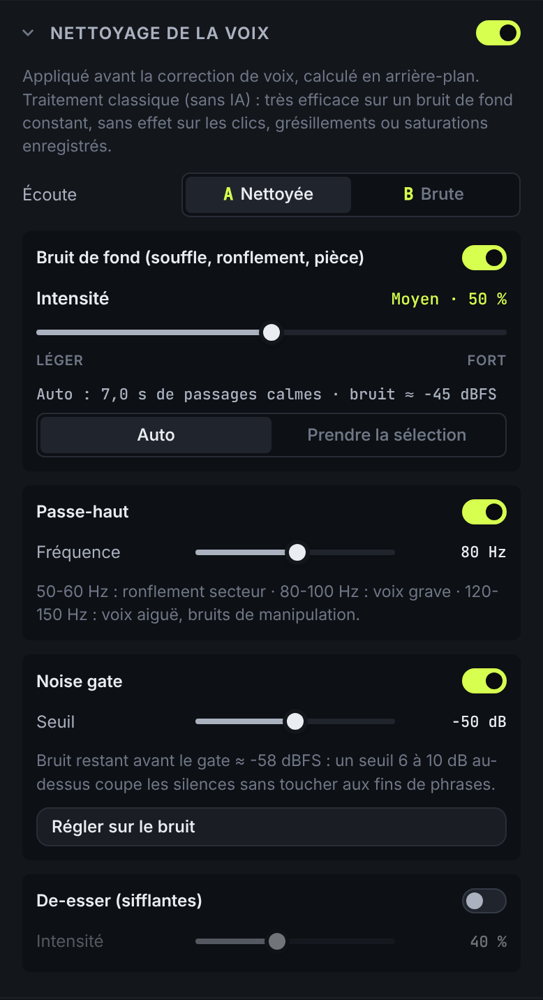
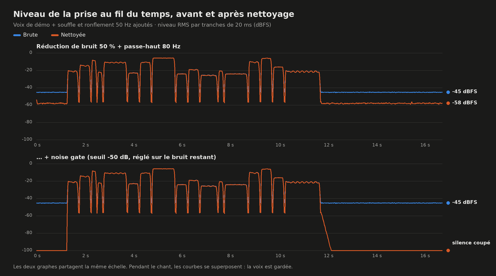

# Nettoyage de la voix



## Utilisation

Mini-menu d'une piste (« … » ou clic droit) ▸ **Nettoyage de la voix**. Le
panneau FX s'ouvre sur la section de CETTE piste. L'interrupteur de la section
active le nettoyage. Ses quatre outils s'allument et s'éteignent séparément :

| Outil             | Réglage                                | Contre quoi                                                                                                   |
| ----------------- | -------------------------------------- | ------------------------------------------------------------------------------------------------------------- |
| **Bruit de fond** | Intensité, de léger à fort             | Souffle du micro ou du préampli, ronflement électrique, ventilation, bruit de pièce : tout bruit **constant** |
| **Passe-haut**    | Fréquence 20-300 Hz (80 Hz par défaut) | Ronflement 50/60 Hz, grondements, chocs sur le pied de micro, vent léger                                      |
| **Noise gate**    | Seuil, ou « Régler sur le bruit »      | Ce qui reste dans les silences entre les phrases                                                              |
| **De-esser**      | Intensité                              | Sifflantes trop fortes (s, ch, z)                                                                             |

- **Empreinte du bruit** :
  - En mode **Auto**, Bandloop prend les passages les plus calmes de la prise
    (10 % du bas) comme modèle du bruit. Il affiche leur durée et le niveau
    mesuré (« Auto : 7,0 s de passages calmes · bruit ≈ −45 dBFS »).
  - Si la prise n'a presque pas de vrai silence, un avertissement le signale.
    Dans ce cas, glisse dans la timeline sur une zone où l'on n'entend **que
    le bruit** (avant la première phrase, idéalement), puis clique
    « **Prendre la sélection** ». Il faut au moins 0,15 s.
- **Régler sur le bruit** place le seuil du gate 8 dB au-dessus du bruit qui
  reste après la réduction. Ce bruit est mesuré par le dernier calcul.
- **Écoute A/B** : A = voix nettoyée (et corrigée, si la correction est
  active), B = voix brute. C'est une simple écoute : l'export et le projet
  gardent toujours la voix traitée.
- **Annulation** : chaque réglage s'annule (Ctrl/⌘+Z). Un glisser de curseur
  compte pour une seule entrée.
- **Blocage** : pendant un enregistrement, le panneau et le mini-menu sont
  bloqués.
- **Projet** : réglages et empreinte (la zone, pas le spectre) sont
  enregistrés avec la piste. Le nettoyage n'est **pas** dans les presets
  vocaux : il dépend de la prise, pas du style de voix. Appliquer un preset
  ne le change pas.

## Place dans la chaîne

```
voix d'origine ─ NETTOYAGE ─ étage de hauteur (correction, harmonies…) ─ chaîne temps réel ─ console
                 passe-haut → réduction de bruit + de-esser → gate
```

- **Nettoyer d'abord, corriger ensuite.** La correction et les harmonies
  travaillent sur la voix nettoyée : le bruit n'est pas recopié dans les
  harmonies.
- Le tout est **un seul rendu** hors temps réel, dans le Web Worker. Il est
  relancé 250 ms après le dernier réglage ; pendant ce temps, la piste joue
  l'ancien rendu.
- **Lecture et export utilisent le même rendu**, testé : l'export prend
  toujours la voix traitée, même si on écoute B.
- La **détection de hauteur** reste celle de la voix d'origine : elle n'est
  calculée qu'une fois par piste. Le nettoyage est à **phase nulle**, donc la
  voix nettoyée reste alignée échantillon par échantillon sur l'originale.
- Pas de nettoyage en direct au micro : comme la correction, il se calcule
  après la prise.

## Techniques (écrites de zéro, domaine public)

- **Passe-haut** : biquad de Butterworth du 2e ordre (formules RBJ), appliqué
  dans un sens puis dans l'autre. On obtient 24 dB/octave et **aucun
  déphasage**, avec −6 dB à la fréquence choisie.
- **Réduction de bruit** : soustraction spectrale (S. Boll, 1979).
  - Transformée de Fourier à court terme : trames de 46 ms, fenêtre de Hann,
    recouvrement 75 %.
  - Gain par fréquence : `max(plancher, 1 − β·bruit/signal)`.
  - L'intensité règle la sur-soustraction β (1 → 3,5) et le plancher (−6 →
    −30 dB). Le plancher est ce qui évite de « trouer » le son.
  - Le gain est lissé en fréquence et en temps (ouverture rapide, fermeture
    plus lente) pour limiter le **bruit musical**, ces gazouillis typiques
    d'une soustraction trop forte.
- **De-esser** : dans la même passe, quand l'énergie de 5-10 kHz s'approche à
  moins de 10 dB de celle du cœur de la voix (300 Hz-3 kHz), les fréquences
  au-dessus de 4,5 kHz sont atténuées, jusqu'à −12 dB à 100 %.
- **Noise gate** :
  - enveloppe RMS sur 5 ms ;
  - hystérésis de 4 dB ;
  - maintien de 60 ms ;
  - **anticipation** de 5 ms, possible hors temps réel, pour ne pas couper
    les attaques ;
  - fermeture à −60 dB en 80 ms.

## Ce que ça donne vraiment (mesuré)



Mesures sur des signaux de test (`test/denoise.test.js`) et sur la voix de
démo, avec un souffle à −45 dBFS :

| Réglage             | Bruit dans les silences                                    | Bruit pendant le chant (hors harmoniques de la voix) | Niveau de la voix                |
| ------------------- | ---------------------------------------------------------- | ---------------------------------------------------- | -------------------------------- |
| Bruit de fond 20 %  | −6,6 dB                                                    | −6,5 dB                                              | inchangé (±0,02 dB)              |
| Bruit de fond 50 %  | −11 dB                                                     | −11 dB                                               | inchangé                         |
| Bruit de fond 100 % | −19 dB                                                     | −18 dB                                               | inchangé                         |
| + noise gate        | coupé (−60 dB) dans les vrais silences                     | —                                                    | inchangé                         |
| Passe-haut          | ronflement 50 Hz : −18 dB (coupure 80 Hz), −30 dB (120 Hz) | —                                                    | inchangé au-dessus de la coupure |
| De-esser 100 %      | —                                                          | sifflante synthétique : −5 dB et plus                | voyelles : < 0,5 dB              |

Temps de calcul : environ 5 s pour une prise de 3 min avec tous les outils,
en plus de la correction éventuelle.

## Limites (sans enjoliver)

### Ce qui marche bien

- **Bruit de fond constant** : souffle, ronflement électrique et ses
  harmoniques, ventilation régulière, bruit de pièce stable. C'est le cas
  idéal de la soustraction spectrale.
- **Ronflement 50/60 Hz** : le passe-haut le réduit fortement (−18 dB à 80 Hz,
  −30 dB à 120 Hz), puis la réduction de bruit traite le reste et ses
  harmoniques (100, 150 Hz…) comme un bruit constant.
- **Silences entre les phrases** : le gate, réglé sur le bruit restant, les
  rend vraiment silencieux.

### Ce qui marche moyennement

- **Le bruit pendant le chant** n'est réduit que là où la voix n'est pas. Aux
  fréquences des harmoniques de la voix, le bruit et la voix se mélangent : on
  ne peut pas les séparer sans abîmer la voix. Le bruit restant est en partie
  masqué par la voix, mais il est toujours là.
- **Intensité forte** : au-delà de ~70 %, un léger « bruit musical »
  (gazouillis) et un son un peu « sous l'eau » peuvent apparaître sur les
  souffles et les fins de notes. Mieux vaut une intensité moyenne et le gate.
- **Bruit qui varie** (circulation, gens qui parlent, musique dans la pièce,
  climatisation qui démarre) : l'empreinte est une moyenne fixe, elle ne suit
  pas les changements.
- **Prise sans silence** : l'empreinte automatique contient de la voix, le
  nettoyage enlève alors un peu de voix. L'avertissement le signale ; la
  solution est une zone choisie à la main.
- **Gate** :
  - les pauses très courtes entre deux syllables restent ouvertes, à cause du
    maintien de 60 ms, voulu pour ne pas hacher les fins de mots ;
  - un seuil trop haut coupe les fins de phrases douces et les respirations.
- **De-esser** : un « s » très doux n'est pas touché, et un son aigu voulu
  (cymbale, voix soufflée très brillante) peut être atténué à tort.

### Ce qui ne marche pas

- **Clics, craquements, grésillements irréguliers, plosives (« p », « b »)** :
  ce sont des bruits brefs, pas constants. Ils ne sont pas dans l'empreinte et
  passent tels quels ; un test le vérifie. Il faudrait un outil de
  restauration dédié (détection des clics et interpolation), non fourni.
- **Saturation enregistrée** (écrêtage) : la forme d'onde est déjà détruite et
  aucun de ces outils ne la reconstruit.
- **Réverbération de la pièce, écho** : ce n'est pas un bruit additif
  constant, c'est la voix elle-même, retardée.
- **Défauts « gravés » dans la prise** : distorsion du micro, compression MP3
  à bas débit, coupures, son lointain ou étouffé. Le nettoyage enlève du
  bruit, il ne rajoute pas ce qui manque.
- **Séparer une voix d'une musique de fond** : impossible avec ces techniques
  classiques. Les outils qui le font utilisent des réseaux de neurones
  entraînés, que Bandloop n'embarque pas.
- **Stéréo** : comme l'étage de hauteur, le nettoyage travaille sur la somme
  mono de la piste. Une piste stéréo traitée devient mono au centre.

En résumé : sur une prise faite dans une pièce calme avec un micro qui souffle
un peu ou une alimentation qui ronfle, le résultat est net. Sur une prise
mauvaise à la base, aucun réglage ne la rendra propre. Il vaut mieux
réenregistrer.
